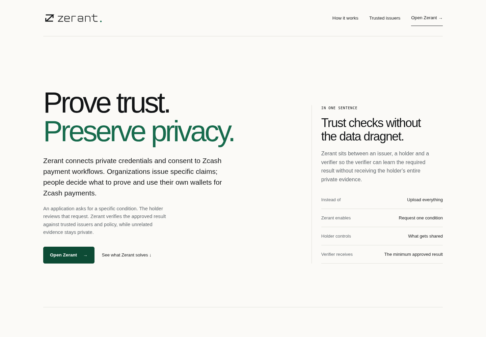
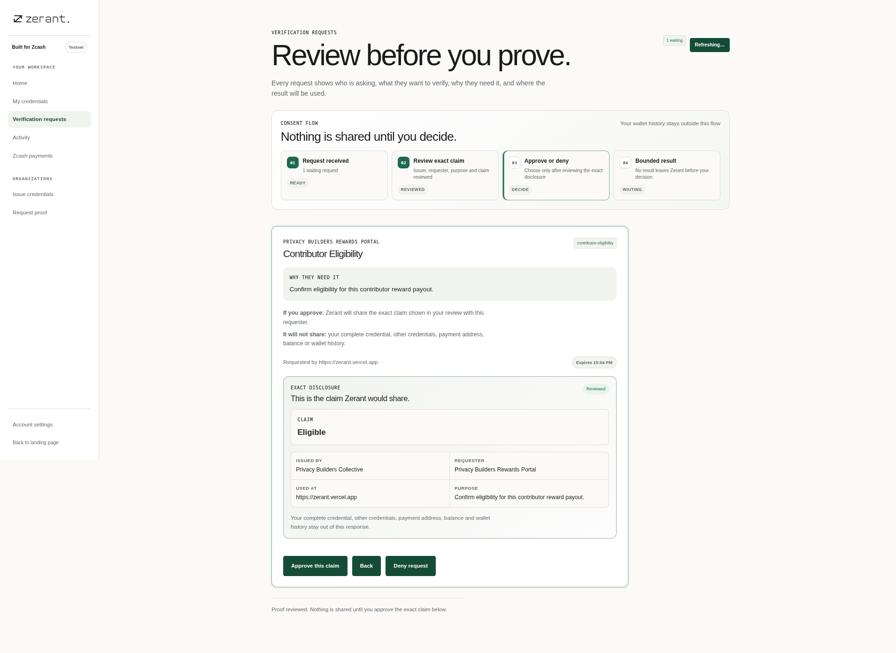
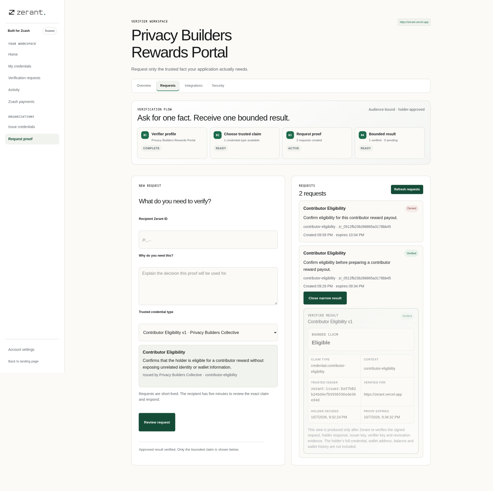
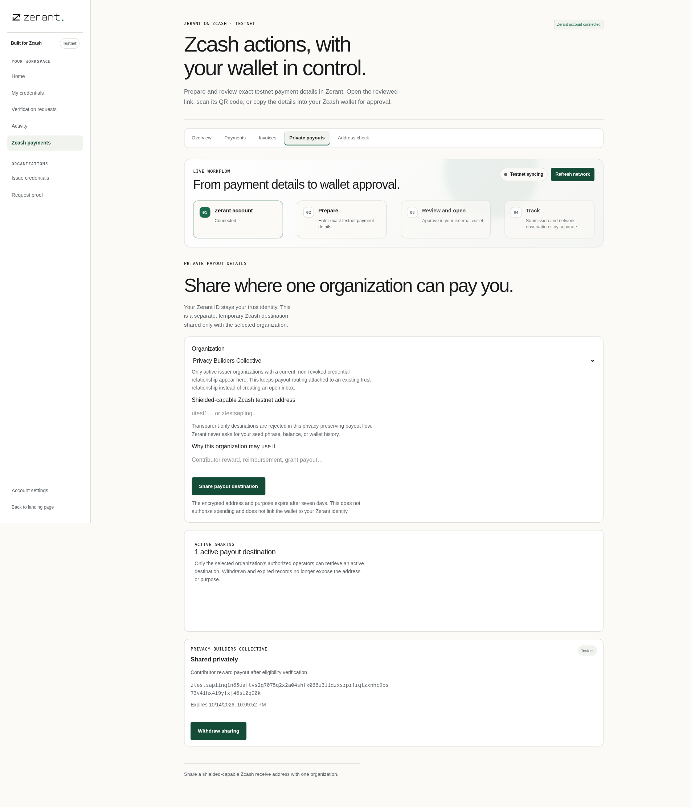
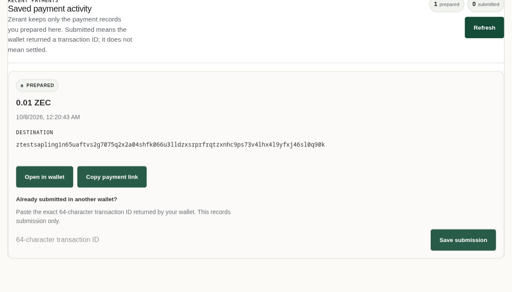

# Zerant Protocol

**Prove trust. Preserve privacy.**

Zerant is a privacy-focused credential and verification platform for the Zcash ecosystem. Organizations issue signed claims, people control their disclosure, and applications verify the specific information they need—without collecting an entire identity profile or wallet history.

**[Launch Zerant](https://zerant.vercel.app)** · **[Watch the product demo](https://youtu.be/P36WelovsiU)** · **[Architecture](docs/ARCHITECTURE.md)** · **[Technical documentation](docs/README.md)**

> **Current status:** Hosted on **Zcash testnet**. Zerant is experimental software. Its credential disclosures are signed and consent-bound, **not zero-knowledge proofs**; its Zcash payment handoff is **not a claim of settled funds**.



## The problem

A rewards platform needs to know whether someone contributed. A community needs to check membership. A marketplace needs to verify a qualification. None of those decisions requires a complete identity document, a list of other credentials, a wallet balance, or someone's transaction history.

Yet many workflows make people disclose that extra information by default.

**Zerant separates three authorities:**

1. **Account access:** who can enter a Zerant workspace.
2. **Disclosure consent:** which exact credential claim can be shared, with whom, and why.
3. **Payment authorization:** whether an external Zcash wallet approves a transaction.

A **Zerant ID is not a Zcash address**. Credentials are not stored on a public chain, and Zerant does not build one global public reputation score.

## What you can use today

| Capability | Implemented workflow |
| --- | --- |
| **Account access** | Passkey registration/sign-in; account and session management; optional supported Zcash-wallet authentication methods with separate consent and key ownership. |
| **Private credential vault** | Signed credentials tied to a holder account, with expiry/revocation state; issuer and claim details remain in the authenticated workspace. |
| **Organizations / issuers** | Organization profiles, scoped owner/admin/issuer/auditor roles, team invitations, credential type definitions and versions, issuance, revocation, and issuer signing-key rotation. |
| **Verification** | Verifier profiles and keys, context-specific claim requests, holder review/approval or denial, issuer trust checks, expiry and revocation enforcement, request binding, and replay protection. |
| **Integrations** | Authenticated verifier API keys and scoped requests, signed webhook delivery, and public issuer trust metadata. |
| **Private payout destinations** | A holder can share a temporary, encrypted, shielded-capable testnet recipient with a chosen issuer organization; the organization only accesses it while permitted. |
| **Zcash payment preparation** | Address and network checks, exact-amount ZIP-321 requests, QR/link handoff to compatible external wallets, and a prepared/submitted activity record. |

These are **distinct systems**: an issued credential is not a payment, a verified claim is not proof of anonymity, and a submitted transaction identifier is not a confirmed shielded settlement.

### Screens from the working product

| Holder consent | Verifier result |
| --- | --- |
|  |  |

| Private payout destination | Prepared Zcash payment |
| --- | --- |
|  |  |

## Follow the end-to-end journey

**Want a quick tour?** Start with the [product video](https://youtu.be/P36WelovsiU). To explore interactively, use the [hosted app](https://zerant.vercel.app) in a current browser with passkey support. No payment wallet is required to issue or verify credentials.

1. **Create an account.** Open **Vault** and register with a passkey. Save your new Zerant ID.
2. **Set up an organization.** Open **Issuer**, create an issuer profile, and define a credential type such as “Community Membership” with a clear description, context, and lifetime.
3. **Issue a credential.** In **Issue credentials**, enter the recipient's **Zerant ID** (not a payment address), choose an active type, enter the factual claim, review, and confirm.
4. **Review the credential.** Sign into the recipient account in a separate browser profile or device; the holder can inspect its issuer and validity in their **Vault**.
5. **Request verification.** In **Verifier**, configure a verifier and request a narrow claim from that Zerant ID. The request names its intended purpose and scope.
6. **Give or decline consent.** The holder reviews the incoming request and explicitly approves or rejects the disclosure. The verifier can obtain only the approved request-bound result.
7. **Explore payments separately.** The **Zcash** workspace prepares a testnet ZIP-321 request. A compatible wallet must approve any spend; the preparation or submission screen **does not prove receipt**.

**Testing note:** Issuer, verifier, and holder views belong to real authenticated accounts. A full two-party walkthrough needs separate accounts/browser profiles. Do not use mainnet funds for testnet flows; never paste wallet recovery phrases into Zerant.

## Architecture at a glance

```text
  Browser (Next.js / React / TypeScript)
     │  Passkeys · Issuer / Holder / Verifier UI · Zcash payment handoff
     ▼
  Server-side application routes
     │  Authenticated, no public backend secrets
     ▼
  Private Rust / Axum API ───────── PostgreSQL / Neon
     │                                Encrypted credential records,
     │                                sessions, authorization, lifecycle state
     ├─ Credential core: canonical data, signatures, issuer trust
     ├─ Disclosure: purpose, audience, consent, verification, replay control
     ├─ Policy: context-specific rules, not a global reputation score
     └─ Zcash integration: network/address checks, ZIP-321, bounded observation

  External Zcash wallet ──> independently approves spending
```

| Path | Responsibility |
| --- | --- |
| [`apps/web/`](apps/web/) | Next.js interface and protected application routes |
| [`services/zerant-api/`](services/zerant-api/) | Rust/Axum API, sessions, issuer/verifier workflows, persistence |
| [`crates/zerant-core/`](crates/zerant-core/) | Common canonical encoding and validation |
| [`crates/zerant-credential/`](crates/zerant-credential/) | Credential schemas, trust, signatures, and revocation |
| [`crates/zerant-policy/`](crates/zerant-policy/) | Context-bound evaluation primitives |
| [`crates/zerant-disclosure/`](crates/zerant-disclosure/) | Selective/minimal disclosure and proof validation |
| [`crates/zerant-zcash/`](crates/zerant-zcash/) | Zcash parsing, payment URI and native integration tools |
| [`fixtures/`](fixtures/) | Regression and protocol fixtures |
| [`docs/`](docs/README.md) | Specifications, architecture, privacy and operational guides |

The service owns sensitive credential operations. Stored credential records use **server-managed encryption**, not holder-only end-to-end encryption. See the [architecture](docs/ARCHITECTURE.md) and [threat model](docs/THREAT_MODEL.md).

## How Zcash fits

Zerant uses **Zcash testnet** for payment-related workflows. It checks network-specific receiving addresses and amount units, creates ZIP-321 payment requests, and hands the request to a compatible wallet via QR code or link. Zerant does **not** collect a wallet seed or spending key.

Credentials, consent decisions, issuer metadata, and verification results are **off-chain**. The current hosted application cannot prove that a specific shielded recipient received an exact amount simply from a submitted transaction identifier. Regtest/Z3 experiments in the Rust tooling are **separate from hosted testnet behavior**.

See [Zcash integration](docs/ZCASH-INTEGRATION.md), [wallet compatibility](docs/WALLET_COMPATIBILITY.md), and [payment specification](docs/specs/payment-v0.1.md).

## Run and test the repository

**Requirements:** Node.js **22.x**, pnpm **10.34.6**, a current Rust toolchain, and PostgreSQL for authenticated backend features. The hosted app is easiest to explore without provisioning local infrastructure.

```bash
# From the repository root:
corepack enable
pnpm install --frozen-lockfile

# Start the Next.js application:
pnpm dev

# Check the web interface:
pnpm lint
pnpm typecheck
pnpm test
pnpm build

# Check the Rust workspace:
cargo fmt --all -- --check
cargo clippy --workspace --all-targets -- -D warnings
cargo test --workspace

# Scan source for common secret patterns:
python3 scripts/secret-check.py
```

The frontend alone does not replace the private API and database. For a complete local setup, start with [backend environment configuration](services/zerant-api/.env.example) and [deployment architecture](docs/VERCEL_DEPLOYMENT.md). Provide **your own** local credentials and keys; do not commit any `.env` files. The GitHub Actions workflow runs web and Rust checks on changes.

## Security, limits and roadmap

- **What credentials prove:** a trusted issuer signed a specific assertion, with explicit holder approval for each supported disclosure. Issuer integrity and policy remain trust assumptions.
- **What they do not prove:** anonymous identity, mathematically hidden-input predicates, full unlinkability, or zero-knowledge proof guarantees.
- **What payment preparation proves:** a wallet-ready request was formed. It does **not** prove a transaction was authorized, broadcast, mined, or delivered to an exact shielded recipient.
- **Where private data lives:** credential and payout data are protected under authenticated, server-managed boundaries. Backend compromise, rare attributes, timing, browser metadata, or collusion can still correlate activity.
- **Operating environment:** **testnet and experimental**, not a production financial or custody service.

For the detail behind those boundaries: [Privacy](docs/PRIVACY.md) · [Threat model](docs/THREAT_MODEL.md) · [Security policy](SECURITY.md) · [Roadmap](docs/ROADMAP.md). The native protocol specifications are maintained under [`docs/specs/`](docs/specs/).

## Links

- **Live product:** https://zerant.vercel.app
- **Demo video:** https://youtu.be/P36WelovsiU
- **Source and issues:** https://github.com/Oluwa-Laughter/zerant-protocol

**Zerant Protocol — Prove trust. Preserve privacy.**
